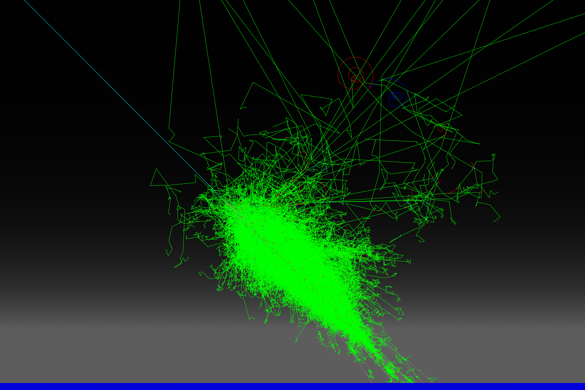

# MusAirS

Simulation of cosmic ray air shower.



## Content

- [MusAirS](#musairs)
  - [Content](#content)
  - [Quick start](#quick-start)
    - [Dependencies](#dependencies)
    - [How to build (GNU/Linux)](#how-to-build-gnulinux)
    - [How to run](#how-to-run)
      - [Interactive session](#interactive-session)
      - [Batch session](#batch-session)
  - [Coordinate convention](#coordinate-convention)
    - [Coordinate system](#coordinate-system)
    - [Angular Coordinate (in result)](#angular-coordinate-in-result)
  - [Choose an alternative physics list](#choose-an-alternative-physics-list)
    - [Physics configuration](#physics-configuration)
  - [Run macro](#run-macro)
  - [Geometry and field](#geometry-and-field)
    - [Atmosphere modeling](#atmosphere-modeling)
      - [States](#states)
      - [Components](#components)
      - [Slicing](#slicing)
    - [Geomagnetic field](#geomagnetic-field)
    - [Elevating the ground](#elevating-the-ground)
  - [Primary particles](#primary-particles)
    - [Primary cosmic ray generator](#primary-cosmic-ray-generator)
      - [Direction sampling](#direction-sampling)
      - [Units](#units)
  - [Save primary vertex data](#save-primary-vertex-data)
  - [Who ordered neutrino?](#who-ordered-neutrino)
  - [Interpret the result](#interpret-the-result)
  - [Output writer target](#output-writer-target)
  - [Bug tracking](#bug-tracking)
  - [Contributing](#contributing)


## Quick start

### Dependencies

MusAirS requires [Mustard (A modern, distributed offline software framework for HEP experiments)](https://github.com/zhao-shihan/Mustard) `0.26.1121` and the [dependencies](https://github.com/zhao-shihan/Mustard?tab=readme-ov-file#required-dependencies) of Mustard:

- ROOT ≥ 6.36.00 (components `Core Imt MathCore Hist Tree ROOTDataFrame ROOTNTuple RIO`),
- Geant4 ≥ 11.0.0 (components `ui_all gdml vis_all`),
- MPI ≥ 4.1,
- CMake ≥ 3.24, Ninja (or GNU Make), and GCC ≥ 13 or Clang ≥ 19.

Mustard is found with CPM: an installed Mustard is used when `find_package` finds one (pass its prefix if necessary), otherwise CPM downloads tag `v0.26.1121` into the source cache `.cache/cpm`. The first configure therefore needs network; later configures reuse the cache.

### How to build (GNU/Linux)

In the source directory, execute:
```sh
cmake -S . -B build -G Ninja -DCMAKE_BUILD_TYPE=Release
cmake --build build -j
```

Useful build options:

| Option | Default | Meaning |
| --- | --- | --- |
| `MUSAIRS_UNITY_BUILD` / `MUSAIRS_FULL_UNITY_BUILD` | `ON` / `ON` | unity build for MusAirS only (unlimited batch) |
| `MUSAIRS_ENABLE_IPO` | `ON` | LTO/IPO in Release, for MusAirS only |
| `MUSAIRS_WERROR` | `OFF` | treat MusAirS compilation warnings as errors |

An in-tree Mustard is configured with `MUSTARD_BUILD_TESTING=OFF`, `MUSTARD_UNITY_BUILD=OFF`, `MUSTARD_FULL_UNITY_BUILD=OFF` and `MUSTARD_USE_FFTW=OFF`; the other `MUSTARD_*` options keep their Mustard defaults.

### How to run

In the build directory, look for help:
```sh
./MusAirS --help
```

Useful runtime options (provided by Mustard's CLI):

| Option | Meaning |
| --- | --- |
| `-v`, `--verbose` | raise verbosity (-2 quiet ... 2 verbose; repeatable, e.g. `-vv`) |
| `-q`, `--quiet` | lower verbosity (repeatable; can be mixed with `-v`) |
| `--lite` | do not print the Mustard banner |
| `--rng <engine>` | random engine: `xoshiro256**`, `xoshiro256++`, `xoshiro256+`, `xoshiro512**` (default), `xoshiro512++`, `xoshiro512+`, `mt1993764`, `mt1993732`, `splitmix64` |
| `--seed <int64>` | seed; `0` means a random device, otherwise deterministic (a predefined deterministic seed is used by default) |
| `--physics-list <list>` | Geant4 reference physics list (default `FTFP_BERT`) |
| `--import-dd`, `--export-dd`, `--emport-dd <yaml>` | detector description import/export/emport before `/run/initialize` |
| `--mustard-version`, `--mustard-version-short` | print the Mustard version |

The random number stream is unified: the environment installs one engine as both CLHEP's global engine and ROOT's `gRandom`, and it is reseeded with mutually exclusive seeds per `/run/beamOn` in MPI runs. Use `--seed` for reproducible production runs.

#### Interactive session

Run interactively:
```sh
./MusAirS
```
or
```sh
./MusAirS -i <macro_for_initialzation>
```

#### Batch session

Run in batch, sequentially:
```sh
./MusAirS <run_macro>
```
Parallel computing:
```sh
mpiexec -n <nproc> ./MusAirS <run_macro>
```
In a parallel run each MPI process writes its own output file inside a process-specific directory named after the requested file, with a `_p<rank>` suffix (e.g. `MusAirS/MusAirS_p0.root`); merge or reduce the per-rank files afterwards.

## Coordinate convention

### Coordinate system

| **Coordinate** | **Direction** |
| -------------- | ------------- |
| +X             | East          |
| -X             | West          |
| +Y             | North         |
| -Y             | South         |
| +Z             | Sky           |
| -Z             | Ground        |

### Angular Coordinate (in result)

| **Coordinate** | **Expression**                     | **Direction**                                                           |
| -------------- | ---------------------------------- | ----------------------------------------------------------------------- |
| phi            | $\mathrm{atan2}(p_x, p_y)+\pi$     | $0$: North, $\frac{\pi}{2}$: East, $\pi$: South, $\frac{3\pi}{2}$: West |
| Zenith         | $1+\frac{p_z}{p}\ (=1-\cos\theta)$ | $0$: Sky, $1$: Horizon                                                  |

## Choose an alternative physics list

MusAirS uses FTFP_BERT as the default physics list. However, you may change it by option `--physics-list`. For example,
```sh
MusAirS --physics-list QGSP_BERT
```
It accepts a [Geant4 reference physics list](https://geant4-userdoc.web.cern.ch/UsersGuides/PhysicsListGuide/html/reference_PL/index.html) name as its argument. Note that electromagnetic physics is forced to `EM Opt1`, so EM physics suffix won't work.

### Physics configuration

The rest of the physics configuration is set by the program itself, so that every run uses it even if the macro says nothing about it:

- The spin-dependent decay process of Geant4 is registered for pions by `G4SpinDecayPhysics` and extended to kaons and $K^0_L$ by `PionKaonDecayMakeSpinPhysics` of [Mustard](https://github.com/zhaoshihan/Mustard).
- The default production cuts are **1 km** for gamma, e- and e+ and **3 m** for the proton. The proton cut is the kinetic-energy threshold of the recoiling nucleus in an elastic scatter, not a threshold for producing protons: in Geant4's linear range-to-energy convention 3 m corresponds to 300 MeV, and inelastic final states are not filtered.
- The neutron tracking cut that comes with the reference lists (10 us, measured from the primary) is replaced by **10 ms** and a **300 MeV** kinetic-energy limit. The default cut would stop every neutron at its first step in an air shower, because a primary that starts at 100 km reaches its first interaction about 280 us later. 10 ms is longer than the longest transit through the world volume, and 300 MeV is at the threshold for pion production on a nucleus, below which a neutron cannot feed the muon component.
- The hadronic and electromagnetic tables are extended to **1 PeV**.
- The optional conversion processes of `G4EmExtraPhysics` (gamma to muon pair, positron to muon pair, muon to muon pair, positron to hadrons) are left at their default disabled state; the electromagnetic production of muons proceeds through the photonuclear processes, which are always on.

The cuts can still be overridden in the macro. For example, the `lite` and `wo_pipm` example macros lower the electromagnetic cuts to 1 pc and kill the electromagnetic shower, which is appropriate when only the muons from pion and kaon decay are of interest:
```sh
/run/setCutForAGivenParticle gamma 1 pc
/run/setCutForAGivenParticle e- 1 pc
/run/setCutForAGivenParticle e+ 1 pc
```
A range cut of 1 pc saturates the range-to-energy conversion at 9.55 GeV; it is a way of switching off the electromagnetic shower, not a physical range of one parsec.

## Run macro

We provided a few example Geant4 macros in `scripts/` directory. Based on them you can write your own.

For more, refer to the [Geant4 Book For Application Developers](https://geant4-userdoc.web.cern.ch/UsersGuides/ForApplicationDeveloper/html/index.html). [General Particle Source](https://geant4-userdoc.web.cern.ch/UsersGuides/ForApplicationDeveloper/html/GettingStarted/generalParticleSource.html) would especially be helpful.

## Geometry and field

There are some adjustable geometric and field parameters. See [the geometry description file](scripts/MusAirS.yaml) (a YAML file) for detail. The unit system is the Geant4 unit system (MeV, mm, ns).

You can adjust these parameters by importing the YAML file through macro commands. For example,
```sh
/Mustard/Detector/Description/Import another.yaml # or,
# Emport = Export, import, and then export. This is useful for debugging.
/Mustard/Detector/Description/Emport another.yaml
```
The same three operations are also available as the command-line options `--import-dd`, `--export-dd` and `--emport-dd`, which run before `/run/initialize`.

### Atmosphere modeling

#### States

The atmosphere is modeled by [The International Standard Atmosphere (ISA)](https://en.wikipedia.org/wiki/International_Standard_Atmosphere). It is a static atmospheric model of how the pressure, temperature and density of the Earth's atmosphere change over a range of altitudes up to 85 km above sea level. The altitude range should be enough for studying air shower up to 10 TeV.

#### Components

The components of atmosphere within the available range of ISA are almost the same as on the ground. Therefore, the air material is built based on `G4_AIR` (dry air) with different pressure, temperature and density.

#### Slicing

Geant4 does not allow basic material properties (density, pressures, etc.) to change continuously. So the atmosphere should be modeled by many slices of air with different pressures. There are 2 slicing scheme: by altitude or by pressure. The former slices the atmosphere with adjacent layers have the same thickness, while the latter slices with adjacent layers have (almost) the same pressure difference. The atmosphere top (max altitude), slicing scheme and the number of slices can be changed in the geometry description YAML file.

### Geomagnetic field

MusAirS allow user to specify a uniform magnetic field. The magnetic field vector can be set in the YAML file. It uses Geant4 unit system ($1~\mathrm{T} = 0.001~\mathrm{MeV}\cdot\mathrm{ns}/\mathrm{mm}^2 = 0.001$).

### Elevating the ground

By default, the detection plane (the ground") is at the sea level (altitude = 0 m). This can be changed in the geometry description YAML file. This allows to simulate the shower measured in a higher altitude (e.g. on a plateau). Note that the ground level should be higher than 0 m and lower than the atmosphere top.

## Primary particles

We use Geant4 [General Particle Source (GPS)](https://geant4-userdoc.web.cern.ch/UsersGuides/ForApplicationDeveloper/html/GettingStarted/generalParticleSource.html) for primary particle generation. For example, the following macro lines configures GPS to generate protons isotopically from 100 km above the sea level, with $E^{-2.7}$ energy spectrum ranges from 3 GeV to 10 TeV.
```sh
/gps/particle         proton
/gps/position         0 0 100 km
/gps/ang/type         iso
/gps/ene/type         Pow
/gps/ene/biasAlpha    -2.7
/gps/ene/min          3 GeV
/gps/ene/max          10 TeV
```
Detailed usage can be found in the [Geant4 Book For Application Developers](https://geant4-userdoc.web.cern.ch/UsersGuides/ForApplicationDeveloper/html/GettingStarted/generalParticleSource.html).

### Primary cosmic ray generator

For air showers, switch to the built-in primary cosmic ray generator:

```sh
/MusAirS/Action/SwitchToPCR
```

It accepts any particle of the Geant4 particle table, and takes the kinetic energy spectrum either from a formula, from a histogram in a ROOT file, or from a graph in a ROOT file:

```sh
/MusAirS/PCR/Particle                    proton
/MusAirS/PCR/Energy/Spectrum/Histogram   primary_cosmic_ray.root AMS_Proton
/MusAirS/PCR/Energy/Min                  3 GeV
/MusAirS/PCR/Energy/Max                  10 TeV
```

Primary vertices are placed on the top of the atmosphere at the point where the initial primary direction points at the ground center `(0, 0, GroundAltitude)`.  By default, the zenith angle $\theta$ is sampled with probability density proportional to $\cos\theta$ over the range of angles accepted by the world volume, and the azimuth angle is uniform.  This is the angular distribution of an isotropic cosmic-ray flux crossing the horizontal ground: the $\cos\theta$ factor is the projected area of the ground, and the finite acceptance of the world volume is included in the direction weight.  The direction sampling can be biased; see [Direction sampling](#direction-sampling).  Only the initial direction is aimed; a charged primary is subsequently deflected by the geomagnetic field during tracking.

The example file `primary_cosmic_ray.root` is built by `scripts/CreatePCRSpectrum.cxx`, which reads the published AMS-02 tables and writes six histograms:

| Histogram | Species | Rigidity range |
| --- | --- | --- |
| `AMS_Proton` | protons | 1.00-1800 GV |
| `AMS_Helium4` | ⁴He | 1.92-3000 GV |
| `AMS_Deuteron` | deuterons | 1.00-1800 GV |
| `AMS_Helium3` | ³He | 1.92-3000 GV |
| `AMS_Hydrogen` | Z = 1 flux as published (p + D) | 1.00-1800 GV |
| `AMS_Helium` | Z = 2 flux as published (⁴He + ³He) | 1.92-3000 GV |

The four species are listed in order of decreasing flux; the two measured totals follow them and are stored for reference only.

The two measured fluxes are the seven-year AMS-02 measurements [Phys. Rept. **894** (2021) 1]; the four species are obtained from them with the measured D/p and ³He/⁴He flux ratios of [Phys. Rev. Lett. **132** (2024) 261001], so that `AMS_Proton` + `AMS_Deuteron` and `AMS_Helium4` + `AMS_Helium3` reproduce the measured Z = 1 and Z = 2 fluxes bin by bin.  Above 21.1 GV, where AMS does not measure deuterons or ³He, the two ratios are continued with the fits given in that Letter; the header of the script documents the construction and the reasons for it.  `AMS_Hydrogen` and `AMS_Helium` are kept for comparisons with the published tables and must not be used in the same composition as the four species spectra, which already add up to them.

The bins of every histogram are the rigidity bins of the measurement converted to the total kinetic energy of the primary in MeV, which for nuclei is the energy of the whole nucleus and not the energy per nucleon, and the content is the flux density per MeV, so that the integral of a bin is the measured flux in that bin, per unit area, time and solid angle, and the integral of a histogram is a physical flux in m⁻² s⁻¹ sr⁻¹.  The histograms carry no bin errors: the published uncertainties are not propagated, because the generator samples central values only and because the correlations between the fluxes and the ratios are not published; the uncertainties are given in the tables of the two references.  The four species have different masses and therefore slightly different abscissae: they are combined with weights proportional to their integral fluxes, not by adding bin contents.

`scripts/run_AMS_lite.mac` (and its `full` and `wo_pipm` variants) runs the four species in a single session, one Geant4 run per species, and writes all of them to one file per process: `G4Run0` protons, `G4Run1` ⁴He, `G4Run2` deuterons, `G4Run3` ³He.  The minimum kinetic energies are chosen so that every species starts at the same 13.3 GV vertical geomagnetic cutoff at Zhaoqing, $E_{k,\min}=\sqrt{(ZR_c)^2+M^2}-M$, i.e. 12.40 GeV for protons, 23.13 GeV for ⁴He, 11.56 GeV for deuterons and 23.94 GeV for ³He; they differ because the kinetic energy is not proportional to the rigidity for different masses.  The particle, the spectrum and the minimum energy can be changed between `beamOn` commands, so a composition is obtained by running the macro once and weighting the runs afterwards.

The spectrum is sampled with one of four modes, selected by

```sh
/MusAirS/PCR/Energy/Sampling/Mode  LogUniformBiased
```

With $f(E)$ the physical spectrum and $g(E)$ the distribution that is sampled, the energy weight of an event is $w_E = f(E)/g(E)$.  The direction sampling contributes an additional weight $w_\Omega$ for every mode, and the total event weight stored in the output is $w_E w_\Omega$; in the default `Normal` direction mode $w_\Omega = 1-u_{\min}^2$.  The weights are stored in the output so that every distribution can be reweighted afterwards.

| Mode               | $g(E)$                          | $w_E(E)$                    | Use                                                               |
| ------------------ | ------------------------------- | --------------------------- | ----------------------------------------------------------------- |
| `Normal`           | $f/I_f$                         | $I_f$                       | reference; best for the lowest decade, cheapest per event         |
| `UniformBiased`    | $1/(E_{\max}-E_{\min})$         | $f(E)(E_{\max}-E_{\min})$   | exploring a wide range quickly                                    |
| `LogUniformBiased` | $1/[E\ln(E_{\max}/E_{\min})]$   | $fE\ln(E_{\max}/E_{\min})$  | recommended for production: equal statistics per decade of energy |
| `CustomBiased`     | $G/I_G$                         | $f(E)I_G/G(E)$              | shaping the sample toward the observable of interest              |

The `Normal`, `UniformBiased`, `LogUniformBiased`, and `CustomBiased` modes use normalized sampling distributions, so their weights are exact importance ratios.  Formula and graph normalization use the same log-spaced grid for positive energy ranges and linear grid for direction.  Histogram normalization sums bin content times the overlap of each bin with the sampled range, so truncated edge bins are handled explicitly.  In `Normal`, the weight is the spectrum integral $I_f=\int_{E_{\min}}^{E_{\max}} f(E)\,\mathrm{d}E$ over the sampled range, so its expectation is $I_f$; the other modes include the corresponding integral through $f/g$.  For `CustomBiased`, $I_G=\int_{E_{\min}}^{E_{\max}} G(E)\,\mathrm{d}E$ and the weight is $f(E)I_G/G(E)$; the custom spectrum must have a finite positive integral and must be strictly positive over the sampled range.  Zero-density subintervals are not supported.  Custom energy histograms and graphs are interpreted as densities with respect to $E$; counts must be divided by the bin width regardless of bin uniformity, and the histogram or graph must cover the sampling range.  If the sampled range cuts through a histogram bin, the bin content is treated as a density over the truncated width; the same partial interval is used for both sampling and normalization.  The `Normal` and `CustomBiased` energy samplers use the CDF cached internally by `TF1`; `UniformBiased` and `LogUniformBiased` sample analytically.  The stored $w_E$ already contains the absolute energy normalization; when combining runs, use exposure or composition weights rather than multiplying by $\int f\,\mathrm{d}E$ again.  The energy weight is the energy-integrated flux (units of $\int f\,\mathrm{d}E$), while the direction weight is dimensionless.

#### Direction sampling

The zenith angle of the primary is sampled over $\cos\theta \in [\cos\theta_{\max}, 1]$, where $\theta_{\max}$ is set by the world width and the atmosphere/ground geometry (the inscribed cylinder of the world box is used, a conservative truncation of the box corners), and the azimuth angle is uniform.  The mode is selected by

```sh
/MusAirS/PCR/Direction/Sampling/Mode  Normal
```

The `ZenithPowerBiased` exponent, the `CustomBiased` distribution, and its sampling resolution are set by

```sh
/MusAirS/PCR/Direction/Sampling/Power             2
/MusAirS/PCR/Direction/Sampling/Custom/Formula    x^2
/MusAirS/PCR/Direction/Sampling/Custom/Histogram  direction.root h
/MusAirS/PCR/Direction/Sampling/Custom/Graph      direction.root g
/MusAirS/PCR/Direction/Sampling/Custom/NPoint     10000
```

For `CustomBiased`, the variable of a formula and the abscissa of a histogram or graph are $x = \cos\theta$ over $[\cos\theta_{\max}, 1]$.  The custom direction spectrum is sampled with ROOT's cached CDF on `NPoint` points (default 10000, range 10-10000000).  ROOT builds the CDF on first use; `SetRange` and `SetNpx` invalidate it.  The generator sets the range only when the spectrum, `NPoint`, or geometry changes, not on every event, so the cached CDF is reused.  `NPoint` controls the CDF accuracy and the one-time build cost, not the per-event cost.  For formula and graph spectra, the normalization grid uses a log-spaced grid for positive energy ranges and a linear grid for direction, with at least 1,000,000 points and following `NPoint` above that floor.  Histogram normalization is exact and does not depend on `NPoint`.  If a sampled spectrum has a feature narrower than the CDF grid, increase `NPoint`; the CDF has `NPoint` points.  Custom direction histograms and graphs are interpreted as densities with respect to $x$; counts must be divided by the bin width regardless of bin uniformity, and the histogram or graph must cover the sampling range.

Let $f(\Omega) = \cos\theta/\pi$ be the physical angular distribution over the full downward hemisphere, and let $u_{\min}=\cos\theta_{\max}$.  The world accepts the fraction $1-u_{\min}^2$ of this distribution, and the direction weight includes that acceptance.  The modes sample $g(\Omega)$ and assign

| Mode                | $g(\Omega)$             | $w_\Omega(\Omega)$                                                                 |
| ------------------- | ----------------------- | ---------------------------------------------------------------------------------- |
| `Normal`            | $\propto \cos\theta$    | $1-u_{\min}^2$                                                                     |
| `ZenithPowerBiased` | $\propto \cos^n\theta$  | $\frac{2}{n+1}(1-u_{\min}^{n+1})\cos^{1-n}\theta$                                  |
| `CustomBiased`      | $\propto G(\cos\theta)$ | $\frac{2\cos\theta\,I_G}{G(\cos\theta)}$                                           |

Here $G(\cos\theta)$ is the user-supplied custom distribution, and for `CustomBiased` $I_G=\int_{u_{\min}}^1 G(u)\,\mathrm{d}u$.  The `ZenithPowerBiased` exponent must be finite and non-negative; the default is $n=2$, so the `Power` command can be omitted when that value is wanted.  $n=1$ reproduces `Normal`, and $n=0$ gives a uniform distribution in $\cos\theta$ (uniform solid angle).  The physical $f(\Omega)$ is normalized over the full downward hemisphere; each mode's weight has expectation $1-u_{\min}^2$ over the accepted cone, and the custom direction spectrum must have a finite positive integral and must be strictly positive over the sampled range.

#### Units

The unit system is the Geant4 one (MeV, mm, ns). In particular **the variable of a spectrum formula is the kinetic energy in MeV**, so a formula containing an explicit energy scale must be written in MeV: a spectrum with a cutoff at 10 TeV is `exp(-x/1e7)`, not `exp(-x/1e4)`. Scale-free power laws such as `x^-2.7` are unaffected. The same applies to a formula given to `/MusAirS/PCR/Energy/Sampling/Custom/Formula`, and to a spectrum read from a graph or a histogram, whose abscissa is also the kinetic energy in MeV. The `/MusAirS/PCR/Energy/Min` and `/MusAirS/PCR/Energy/Max` commands, in contrast, take a value with a unit; a value outside the range of the spectrum is clamped to the nearest end of that range, with a warning, and a minimum that is not below the current maximum, or a maximum that is not above the current minimum, is an error.  The minimum kinetic energy must be positive; spectra or commands with $E_{\min}\le 0$ are rejected.  Direction custom distributions use the dimensionless variable $x = \cos\theta$.

## Save primary vertex data

Primary vertices are not recorded by default. You can enable saving primary vertices by the command
```sh
/MusAirS/Analysis/SavePrimaryVertexData yes
```
This can sometimes be useful in debugging.

## Who ordered neutrino?

Neutrino hits are not recorded by default (since there are to much neutrino). You can let `EarthSD` to record neutrino hits by the command
```sh
/MusAirS/SD/EarthSD/DetectNeutrino yes
```

## Interpret the result

The output ROOT file contains one directory per Geant4 run (`G4Run<id>`), and each directory contains the primaries (`PrimaryVertex`, if enabled) and one `ReactionChain(<PDG ID>)` collection per primary particle species that hit the ground. The reaction chain is ordered by track ID, so a parent always precedes its children.

By default the analysis writes ROOT `RNTuple`s, which `ROOT::RDataFrame` reads directly by their directory-qualified name:

```c++
ROOT::RDataFrame df{"G4Run0/ReactionChain(22)", "MusAirS_p0.root"};
const auto muonEnergy = df.Take<double>("Ek0");
```

To write `TTree`s instead (e.g. for `hadd` or `TTree::Draw`), set `MUSTARD_DATA_WRITER_DEFAULT_TARGET=TTree` in the environment, or run `/MusAirS/Analysis/WriterTarget TTree` before `/run/beamOn`; the same collection names are preserved. A `TTree` collection lives in a ROOT directory, so read it through the file and the directory, or use `TTree::Draw` directly:

```c++
TFile file("MusAirS_p0.root");
auto tree = (TTree*)((TDirectoryFile*)file.Get("G4Run0"))->Get("ReactionChain(22)");
tree->Draw("Ek0", "Weight > 0");

ROOT::RDataFrame df{*tree};
```

When running in parallel, every MPI process writes its own file into a process-specific directory with a `_p<rank>` suffix (e.g. `MusAirS/MusAirS_p0.root`); merge or read the per-rank files together afterwards (e.g. `hadd` when writing `TTree`s). The output columns include the event and direction weights (`Weight`), so every distribution can be reweighted afterwards.

## Output writer target

The analysis writes ROOT `RNTuple`s by default. The output format can be changed either by the `MUSTARD_DATA_WRITER_DEFAULT_TARGET` environment variable (`RNTuple` or `TTree`) or at run time with

```sh
/MusAirS/Analysis/WriterTarget RNTuple  # default
/MusAirS/Analysis/WriterTarget TTree    # one TTree per collection instead
```

This is the `Mustard::Data::Writer` backend selection of Mustard 0.26.1121.

## Bug tracking

Open an issue if you found any defects or bugs.

## Contributing

Open a pull request whenever you want.
