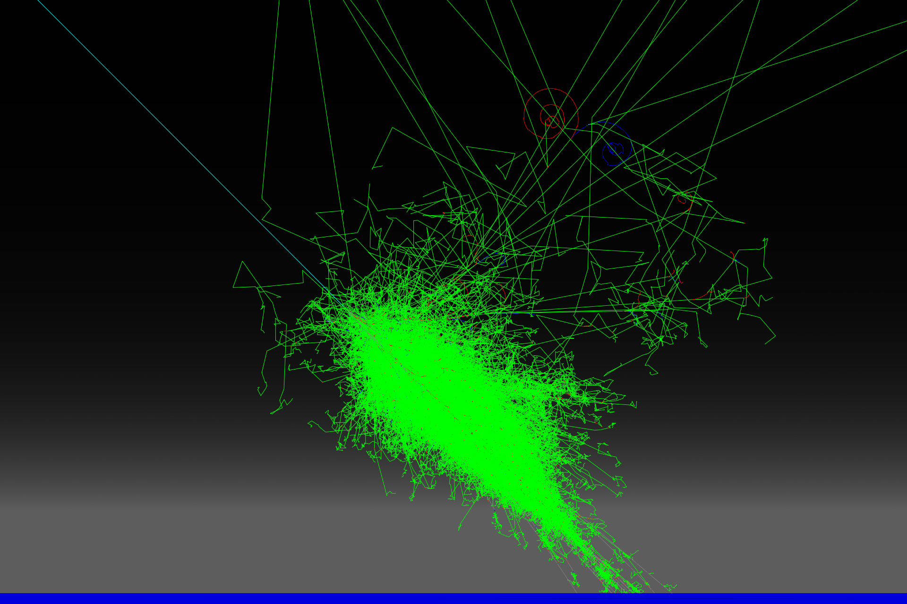

# MusAirS

Simulation of cosmic ray air shower.



## Content

- [MusAirS](#musairs)
  - [Content](#content)
  - [Quick start](#quick-start)
    - [Dependencies](#dependencies)
    - [How to build (GNU/Linux)](#how-to-build-gnulinux)
    - [How to run](#how-to-run)
      - [Interactive session](#interactive-session)
      - [Batch session](#batch-session)
  - [Coordinate convention](#coordinate-convention)
    - [Coordinate system](#coordinate-system)
    - [Angular Coordinate (in result)](#angular-coordinate-in-result)
  - [Choose an alternative physics list](#choose-an-alternative-physics-list)
    - [Physics configuration](#physics-configuration)
  - [Run macro](#run-macro)
  - [Geometry and field](#geometry-and-field)
    - [Atmosphere modeling](#atmosphere-modeling)
      - [States](#states)
      - [Components](#components)
      - [Slicing](#slicing)
    - [Geomagnetic field](#geomagnetic-field)
    - [Elevating the ground](#elevating-the-ground)
  - [Primary particles](#primary-particles)
    - [Primary cosmic ray generator](#primary-cosmic-ray-generator)
      - [Units](#units)
  - [Save primary vertex data](#save-primary-vertex-data)
  - [Who ordered neutrino?](#who-ordered-neutrino)
  - [Interpret the result](#interpret-the-result)
  - [Bug tracking](#bug-tracking)
  - [Contributing](#contributing)


## Quick start

### Dependencies

Required, built-in if not found (network or pre-downloaded source is required):

1. [Mustard (A modern, distributed offline software framework for HEP experiments)](https://github.com/zhao-shihan/Mustard) (≥ 0.26.315, built-in if not found) and its [dependencies](https://github.com/zhao-shihan/Mustard?tab=readme-ov-file#dependencies).

### How to build (GNU/Linux)

In source directory, execute line-by-line:
```sh
mkdir build
cd build
cmake ..
make -j8
```

### How to run

In build directory, look help:
```sh
./MusAirS --help
```

#### Interactive session

Run interactively:
```sh
./MusAirS
```
or
```sh
./MusAirS -i <macro_for_initialzation>
```

#### Batch session

Run in batch, sequentially:
```sh
./MusAirS <run_macro>
```
Parallel computing:
```sh
mpirun -n <nproc> ./MusAirS <run_macro>
```

## Coordinate convention

### Coordinate system

| **Coordinate** | **Direction** |
| -------------- | ------------- |
| +X             | East          |
| -X             | West          |
| +Y             | North         |
| -Y             | South         |
| +Z             | Sky           |
| -Z             | Ground        |

### Angular Coordinate (in result)

| **Coordinate** | **Expression**                     | **Direction**                                                           |
| -------------- | ---------------------------------- | ----------------------------------------------------------------------- |
| phi            | $\mathrm{atan2}(p_x, p_y)+\pi$     | $0$: North, $\frac{\pi}{2}$: East, $\pi$: South, $\frac{3\pi}{2}$: West |
| Zenith         | $1+\frac{p_z}{p}\ (=1-\cos\theta)$ | $0$: Sky, $1$: Horizon                                                  |

## Choose an alternative physics list

MusAirS uses FTFP_BERT as the default physics list. However, you may change it by option `--physics-list`. For example,
```sh
MusAirS --physics-list QGSP_BERT
```
It accepts a [Geant4 reference physics list](https://geant4-userdoc.web.cern.ch/UsersGuides/PhysicsListGuide/html/reference_PL/index.html) name as its argument. Note that electromagnetic physics is forced to `EM Opt1`, so EM physics suffix won't work.

### Physics configuration

The rest of the physics configuration is set by the program itself, so that every run uses it even if the macro says nothing about it:

- The spin-dependent decay process of Geant4 is registered for pions by `G4SpinDecayPhysics` and extended to kaons and $K^0_L$ by `PionKaonDecayMakeSpinPhysics` of [Mustard](https://github.com/zhaoshihan/Mustard).
- The default production cuts are **1 km** for gamma, e- and e+ and **3 m** for the proton. The proton cut is the kinetic-energy threshold of the recoiling nucleus in an elastic scatter, not a threshold for producing protons: in Geant4's linear range-to-energy convention 3 m corresponds to 300 MeV, and inelastic final states are not filtered.
- The neutron tracking cut that comes with the reference lists (10 us, measured from the primary) is replaced by **10 ms** and a **300 MeV** kinetic-energy limit. The default cut would stop every neutron at its first step in an air shower, because a primary that starts at 100 km reaches its first interaction about 280 us later. 10 ms is longer than the longest transit through the world volume, and 300 MeV is at the threshold for pion production on a nucleus, below which a neutron cannot feed the muon component.
- The hadronic and electromagnetic tables are extended to **1 PeV**.
- The optional conversion processes of `G4EmExtraPhysics` (gamma to muon pair, positron to muon pair, muon to muon pair, positron to hadrons) are left at their default disabled state; the electromagnetic production of muons proceeds through the photonuclear processes, which are always on.

The cuts can still be overridden in the macro. For example, the `lite` and `wo_pipm` example macros lower the electromagnetic cuts to 1 pc and kill the electromagnetic shower, which is appropriate when only the muons from pion and kaon decay are of interest:
```sh
/run/setCutForAGivenParticle gamma 1 pc
/run/setCutForAGivenParticle e- 1 pc
/run/setCutForAGivenParticle e+ 1 pc
```
A range cut of 1 pc saturates the range-to-energy conversion at 9.55 GeV; it is a way of switching off the electromagnetic shower, not a physical range of one parsec.

## Run macro

We provided a few example Geant4 macros in `scripts/` directory. Based on them you can write your own.

For more, refer to the [Geant4 Book For Application Developers](https://geant4-userdoc.web.cern.ch/UsersGuides/ForApplicationDeveloper/html/index.html). [General Particle Source](https://geant4-userdoc.web.cern.ch/UsersGuides/ForApplicationDeveloper/html/GettingStarted/generalParticleSource.html) would especially be helpful.

## Geometry and field

There are some adjustable geometric and field parameters. See [the geometry description file](scripts/MusAirS.yaml) (a YAML file) for detail. The unit system is the Geant4 unit system (MeV, mm, ns).

You can adjust these parameters by importing the YAML file through macro commands. For example,
```sh
/Mustard/Detector/Description/Import another.yaml # or,
# Ixport = Export, import, and then export. This is useful for debugging.
/Mustard/Detector/Description/Ixport another.yaml
```

### Atmosphere modeling

#### States

The atmosphere is modeled by [The International Standard Atmosphere (ISA)](https://en.wikipedia.org/wiki/International_Standard_Atmosphere). It is a static atmospheric model of how the pressure, temperature and density of the Earth's atmosphere change over a range of altitudes up to 85 km above sea level. The altitude range should be enough for studying air shower up to 10 TeV.

#### Components

The components of atmosphere within the available range of ISA are almost the same as on the ground. Therefore, the air material is built based on `G4_AIR` (dry air) with different pressure, temperature and density.

#### Slicing

Geant4 does not allow basic material properties (density, pressures, etc.) to change continuously. So the atmosphere should be modeled by many slices of air with different pressures. There are 2 slicing scheme: by altitude or by pressure. The former slices the atmosphere with adjacent layers have the same thickness, while the latter slices with adjacent layers have (almost) the same pressure difference. The atmosphere top (max altitude), slicing scheme and the number of slices can be changed in the geometry description YAML file.

### Geomagnetic field

MusAirS allow user to specify a uniform magnetic field. The magnetic field vector can be set in the YAML file. It uses Geant4 unit system ($1~\mathrm{T} = 0.001~\mathrm{MeV}\cdot\mathrm{ns}/\mathrm{mm}^2 = 0.001$).

### Elevating the ground

By default, the detection plane (the ground") is at the sea level (altitude = 0 m). This can be changed in the geometry description YAML file. This allows to simulate the shower measured in a higher altitude (e.g. on a plateau). Note that the ground level should be higher than 0 m and lower than the atmosphere top.

## Primary particles

We use Geant4 [General Particle Source (GPS)](https://geant4-userdoc.web.cern.ch/UsersGuides/ForApplicationDeveloper/html/GettingStarted/generalParticleSource.html) for primary particle generation. For example, the following macro lines configures GPS to generate protons isotopically from 100 km above the sea level, with $E^{-2.7}$ energy spectrum ranges from 3 GeV to 10 TeV.
```sh
/gps/particle         proton
/gps/position         0 0 100 km
/gps/ang/type         iso
/gps/ene/type         Pow
/gps/ene/biasAlpha    -2.7
/gps/ene/min          3 GeV
/gps/ene/max          10 TeV
```
Detailed usage can be found in the [Geant4 Book For Application Developers](https://geant4-userdoc.web.cern.ch/UsersGuides/ForApplicationDeveloper/html/GettingStarted/generalParticleSource.html).

### Primary cosmic ray generator

For air showers, switch to the built-in primary cosmic ray generator:

```sh
/MusAirS/Action/SwitchToPCR
```

It accepts any particle of the Geant4 particle table, and takes the kinetic energy spectrum either from a formula, from a histogram in a ROOT file, or from a graph in a ROOT file:

```sh
/MusAirS/PCR/Particle                    proton
/MusAirS/PCR/Energy/Spectrum/Histogram   primary_cosmic_ray.root AMS_Proton
/MusAirS/PCR/Energy/Min                  3 GeV
/MusAirS/PCR/Energy/Max                  10 TeV
```

Primary vertices are placed on the top of the atmosphere at the point where the initial primary direction points at the ground center `(0, 0, GroundAltitude)`.  The zenith angle $\theta$ is sampled with probability density proportional to $\cos\theta$ over the range of angles accepted by the world volume, and the azimuth angle is uniform.  This is the angular distribution of an isotropic cosmic-ray flux crossing the horizontal ground: the $\cos\theta$ factor is the projected area of the ground, not an extra event weight.  The event weight therefore still accounts only for the energy sampling.  Only the initial direction is aimed; a charged primary is subsequently deflected by the geomagnetic field during tracking.

The example file `primary_cosmic_ray.root` is built by `scripts/CreateEnergySpectrum.cxx` and holds the seven-year AMS-02 proton and helium fluxes [Phys. Rept. **894** (2021) 1] as the histograms `AMS_Proton` and `AMS_Helium`.  Their bins are the rigidity bins of the measurement converted to the kinetic energy of the primary in MeV, which for helium is the total kinetic energy of the nucleus and not the energy per nucleon, and their content is the measured flux divided by the bin width, so that the integral over a bin is the measured number of particles in that bin.  Because the normalization is physical, the two spectra can be combined with weights proportional to their integral fluxes when a mixed composition is wanted.

The spectrum is sampled with one of four modes, selected by

```sh
/MusAirS/PCR/Energy/Sampling/Mode  LogUniformBiased
```

With $f(E)$ the physical spectrum and $g(E)$ the distribution that is sampled, an event carries the weight $w = f(E)/g(E)$, and the weights are stored in the output so that every distribution can be reweighted afterwards.  The direction sampling already includes the $\cos\theta$ projection of the horizontal ground, so no direction weight is applied; the event weight is solely the energy-sampling weight.

| Mode               | $g(E)$ | $w(E)$                     | Use                                                               |
| ------------------ | ------ | -------------------------- | ----------------------------------------------------------------- |
| `Normal`           | $f$    | $1$                        | reference; best for the lowest decade, cheapest per event         |
| `UniformBiased`    | const  | $f$                        | exploring a wide range quickly                                    |
| `LogUniformBiased` | $1/E$  | $fE\ln(E_{\max}/E_{\min})$ | recommended for production: equal statistics per decade of energy |
| `CustomBiased`     | user   | $f/g$                      | shaping the sample towards the observable of interest             |

#### Units

The unit system is the Geant4 one (MeV, mm, ns). In particular **the variable of a spectrum formula is the kinetic energy in MeV**, so a formula containing an explicit energy scale must be written in MeV: a spectrum with a cutoff at 10 TeV is `exp(-x/1e7)`, not `exp(-x/1e4)`. Scale-free power laws such as `x^-2.7` are unaffected. The same applies to a formula given to `/MusAirS/PCR/Energy/Sampling/Custom/Formula`, and to a spectrum read from a graph or a histogram, whose abscissa is also the kinetic energy in MeV. The `/MusAirS/PCR/Energy/Min` and `/MusAirS/PCR/Energy/Max` commands, in contrast, take a value with a unit; a value outside the range of the spectrum is clamped to the nearest end of that range, with a warning, and a minimum that is not below the current maximum is an error.

## Save primary vertex data

Primary vertices are not recorded by default. You can enable saving primary vertices by the command
```sh
/MusAirS/Analysis/SavePrimaryVertexData yes
```
This can sometimes be useful in debugging.

## Who ordered neutrino?

Neutrino hits are not recorded by default (since there are to much neutrino). You can let `EarthSD` to record neutrino hits by the command
```sh
/MusAirS/SD/EarthSD/DetectNeutrino yes
```

## Interpret the result

// TODO

## Bug tracking

Open an issue if you found any defects or bugs.

## Contributing

Open a pull request whenever you want.
